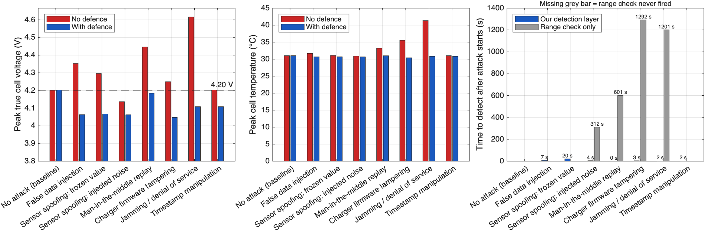
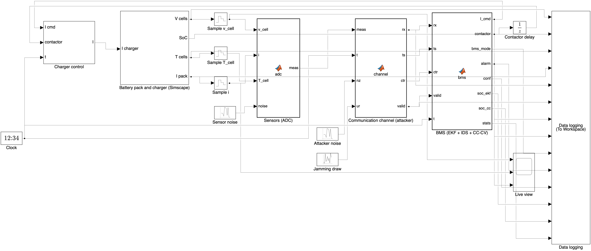
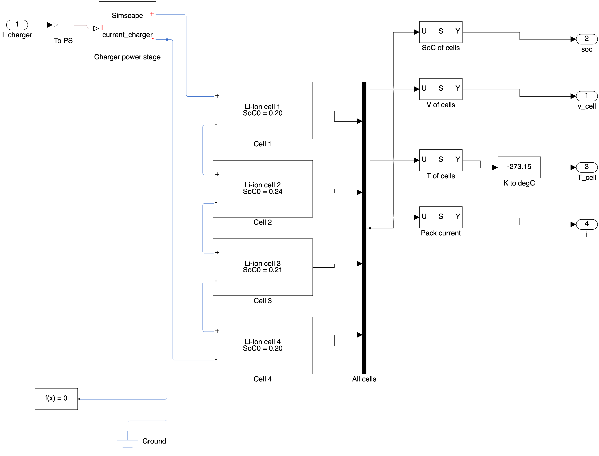

# Cybersecurity and Anomaly Detection in EV Battery Management Systems

Minor project, Department of Electrical Engineering, MNIT Jaipur
Supervisor: Dr. Dipti Saxena
Team: Suhaani Agrawal, Anshika Bansal, Yug Agarwal, Arnav Khandelwal

We simulate an electric-vehicle battery being charged, attack its data in 7 different ways, and
show that a detection layer inside the battery management system (BMS) catches every attack within
seconds and stops charging safely. The whole project is in **MATLAB and Simulink/Simscape**.



| Attack | Without our system | Our system detects it in | Normal BMS limits detect it in |
|---|---|---|---|
| No attack | charges normally to 4.2 V | no false alarms | – |
| False data injection | cell pushed to 4.35 V | 7 s | never |
| Frozen sensor | cell pushed to 4.30 V | 20 s | never |
| Noisy sensor | charging trips early | 4 s | 5 min |
| Replay of old messages | cell pushed to 4.45 V | 0 s | 10 min |
| Charger firmware tampering | 1.8× current, 35 °C | 3 s | 21 min |
| Jamming | **4.62 V, 41 °C** | 2 s | 20 min |
| Timestamp manipulation | SoC reading wrong by 10 % | 2 s | never |

---

## Contents

1. [Set up on your laptop](#1-set-up-on-your-laptop)
2. [Run the project](#2-run-the-project)
3. [Live demo in front of sir](#3-live-demo-in-front-of-sir)
4. [Presentation script: what to speak](#4-presentation-script-what-to-speak)
5. [Questions sir may ask](#5-questions-sir-may-ask)
6. [Troubleshooting](#6-troubleshooting)
7. [What is in this folder](#7-what-is-in-this-folder)

---

## 1. Set up on your laptop

You need **MATLAB** (tested on R2026b; R2024b or newer should work) with these 4 products:
**MATLAB, Simulink, Simscape, Statistics and Machine Learning Toolbox**.
MNIT's campus license covers all of them. Use your **MNIT email** for your MathWorks account.

Pick one option.

### Option A: MATLAB Online (easiest, nothing to install)

1. Go to <https://matlab.mathworks.com> and sign in with your MNIT email.
2. On this GitHub page click **Code → Download ZIP**.
3. In MATLAB Online, in the **Files** panel, click **Upload** and upload the ZIP.
4. In the Command Window type (use the name of the ZIP you uploaded):
   ```matlab
   unzip('EV_BMS_Attack_Sim-main.zip');
   cd EV_BMS_Attack_Sim-main
   ```

### Option B: MATLAB on your own laptop (best for the demo)

1. Go to <https://www.mathworks.com/downloads>, sign in with your MNIT email and download the installer.
2. In the installer select **MATLAB, Simulink, Simscape, Statistics and Machine Learning Toolbox**
   (about 10 GB). Sign in again when MATLAB first opens to activate it.
3. Get the code, either with
   ```bash
   git clone https://github.com/yug105/EV_BMS_Attack_Sim.git
   ```
   or with **Code → Download ZIP** and unzip it.
4. In MATLAB, go to that folder (Current Folder panel, or `cd` in the Command Window).

> **Mac tip:** if MATLAB is installed on an external SSD, plug the SSD in before opening MATLAB.
> If MATLAB seems not to open, quit the MATLAB icon in the Dock and open it again.

### Check your setup

```matlab
ver
```
The list must include Simulink, Simscape, and Statistics and Machine Learning Toolbox.

---

## 2. Run the project

Run everything from the project folder (the one that contains `main.m`).

| Command | What it does | Time |
|---|---|---|
| `main` | MATLAB-script version: all 7 attacks + machine-learning classifier | ~3 min |
| `main_simulink` | builds the Simulink/Simscape model and runs all 7 attacks in it | ~3 min |
| `demo` | open `demo.m` and run it section by section (for the live demo) | < 30 s per section |
| `setup_simulink_run` | prepares the model so you can press **Run** inside Simulink | 5 s |

**Run `main_simulink` once before the demo.** It creates the model file and the detector thresholds
that `demo.m` needs.

Figures and tables are saved to:
- `results/`: script version, including the ML confusion matrix
- `results_simulink/`: Simulink version, plus the model diagrams as PDF (for the report) and PNG (for slides)

### Running the model with the Run button in Simulink

1. Open `setup_simulink_run.m`. At the top, set `ATTACK = 7;` (1–8, listed in the file) and
   `DEFENCE = true;` or `false;`.
2. Run the script. The model opens.
3. In Simulink, double-click the **Live view** block, then press the green **Run** button.
4. When it finishes, type `plot_simulink_run` for the full plot.

---

## 3. Live demo in front of sir

**Before class**
1. Open MATLAB and go to the project folder.
2. Run `main_simulink` (about 3 min).
3. Open `demo.m` and keep it open.
4. Keep `results_simulink/` open in a file browser as a backup.

**In class:** click inside a section of `demo.m` and press **Ctrl+Enter** (Windows) or **Cmd+Enter** (Mac).

| # | Run | What appears | What to say |
|---|---|---|---|
| 1 | Section 1 | list of 7 attacks | "These are the 7 attacks from our mid-sem slides." |
| 2 | Section 2 | the Simulink model | Walk through it left to right (see below). |
| 3 | Section 3 | normal charging plot | "Without an attack the battery charges at constant current, then constant voltage up to 4.2 V, and stops. No false alarms." |
| 4 | Section 4 with `k = 7` | jamming plot | "Red is without our system: the cell reaches 4.62 V and 41 °C. Blue is with our system: we detect it in 2 seconds and stop charging safely." |
| 5 | Section 4 with `k = 2` | false data plot | "The fake values stay inside normal limits, so the normal BMS never notices. Our checks catch it in 7 seconds." |
| 6 | Section 5 | summary bars and table | "All 7 attacks are caught in 0–20 seconds. Normal limits take 5–21 minutes or never catch them. The script and the Simulink model give the same answer." |

**How to read the plots:** red = no defence, blue = with defence, dotted = what the BMS receives,
yellow band = attack active, bottom panel = which detector fired.

**Walking through the Simulink model (left to right)**



1. **Charger control**: the charger firmware (where the tampering attack is placed), the current
   loop, and the contactor that disconnects the battery.
2. **Battery pack and charger (Simscape)**: double-click it to show 4 Li-ion cells in series fed by the
   charger. Each cell is our own Simscape block written as equations in `simulink/+evbms/li_cell.ssc`.
3. **Sensors (ADC)**: reads voltage, current and temperature every second, with sensor noise
   and ADC rounding.
4. **Communication channel (attacker)**: all data passes through here, and every network attack is injected here.
5. **BMS (EKF + IDS + CC-CV)**: estimates state of charge with a Kalman filter, runs 8 detectors,
   controls charging, and stops it safely when an attack is detected.
6. **Live view / Data logging**: graphs and saved results.



---

## 4. Presentation script: what to speak

About 12 minutes in total. Split it between the four of us.

### Speaker 1: the problem (2 min)
- An EV charger, the BMS and the battery exchange data: voltage, current, temperature, commands.
- If an attacker changes that data, the BMS makes wrong decisions: it overcharges, overheats the cell,
  and in the worst case causes thermal runaway.
- In the mid-sem we studied 7 attacks: false data injection, sensor spoofing (frozen and noisy),
  replay, firmware tampering, jamming and timestamp attacks.
- **Our goal:** show in simulation what these attacks do, and build a layer that detects them.

### Speaker 2: the model (3 min), open the Simulink model
- 4 Li-ion cells in series (4S pack), each an equivalent circuit: open-circuit voltage that
  depends on SoC, a series resistance R0, and an R1–C1 branch. It also has a temperature model.
- The charger does constant current at 1C, then constant voltage at 4.2 V, like a real charger.
- Sensors add noise and ADC rounding, so the data looks like real measurements.
- An attacker block sits between the sensors and the BMS. All 7 attacks are injected there using
  the equations from our slides, for example V' = V + ΔV for false data.
- We built it twice, as a MATLAB script and as a Simulink/Simscape model. Both give the same results.

### Speaker 3: our detection layer and the live demo (4 min), run `demo.m`
- The normal BMS only checks limits (above 4.25 V? above 50 °C?). Clever attacks stay inside those limits.
- We added 8 checks based on physics and on the communication protocol:
  1. pack voltage must equal the sum of the cell voltages
  2. measured current must follow the commanded current
  3. Kalman filter: measured voltage must match the model's prediction
  4. a reading cannot stay frozen while current is flowing
  5. sensor noise must stay at its normal level
  6. the message counter must always increase (stops replay)
  7. timestamps must match the message counter
  8. if messages stop arriving, that is jamming
- Thresholds come only from normal charging data, so no attack data was needed to set them, and there are zero false alarms.
- When any check fires, the BMS ramps the current down and disconnects the battery.
- Show sections 3, 4 (jamming) and 4 again (false data) of the demo.

### Speaker 4: results, ML and future work (3 min), show the summary
- Every attack is caught in 0–20 seconds, and the cell stays below 4.2 V.
- Normal BMS limits missed 3 attacks completely and caught the others 5–21 minutes late.
- A machine-learning model (boosted decision trees, MATLAB's equivalent of the XGBoost model in our
  reference paper) identifies *which* attack it is, with 99.8 % accuracy on unseen simulated runs.
- **Limitations:** simulated data, and typical cell parameters rather than measured ones.
- **Next steps:** real measurements from a small cell + ESP32 setup, hardware-in-the-loop
  testing, and secure logging of detected events.

---

## 5. Questions sir may ask

**Why is ML accuracy 99.8 %? Isn't that too high?**
It is on simulated data, where attacks are cleaner than in real life. Real data would be noisier. Testing on real battery data is our next step.

**Where do the battery parameters come from?**
They are typical values for an NMC 18650 cell (2.6 Ah, R0 = 30 mΩ, R1 = 15 mΩ, C1 = 2000 F). With a real cell we
would measure them with a pulse test.

**What if the attacker changes both the cell readings and the pack reading?**
Then the pack-sum check is fooled, but the Kalman-filter check still sees that the voltage does not match
the physics. That is also why prevention (message authentication, secure boot) is needed. Detection is
the second layer, not a replacement.

**Why stop charging? Why not keep going?**
If the data cannot be trusted, stopping is the only safe action. Charging on wrong data is exactly how
overcharge happens.

**Is this real Simscape or just Simulink blocks?**
The battery and charger are a Simscape physical network. The cell is a custom Simscape component
written in the Simscape language (`simulink/+evbms/li_cell.ssc`).

**What is an EKF?**
An Extended Kalman Filter. It predicts the cell voltage from the current and the battery model, then
compares the prediction with the measured voltage. A large difference means the data is wrong.

**How fast does it run?**
One full 83-minute charging session simulates in about 5–10 seconds.

---

## 6. Troubleshooting

| Problem | Fix |
|---|---|
| `Undefined variable bp` when pressing Run in Simulink | Run `setup_simulink_run` first. |
| `demo` says thresholds file not found | Run `main_simulink` once. |
| `ssc_build` or Simscape errors | Check `ver` lists Simscape. In MATLAB Online, sign in with your MNIT account (not the free basic tier). |
| "Unable to find a license" | Open MATLAB normally once and sign in with your MNIT email. |
| Figures look dark | Already handled in our plotting code. For your own figures use `fig.Theme = 'light'`. |
| MATLAB Online asks to stop after 15 min | You are on the free basic tier. Sign in with your MNIT email for the full license. |
| Model diagram looks blurry | Open the `.slx` in Simulink, or use the PDFs in `results_simulink/`. |

---

## 7. What is in this folder

```
main.m                    script version: all attacks + ML
main_simulink.m           Simulink/Simscape version: builds model, runs all attacks
demo.m                    live demo, run section by section
setup_simulink_run.m      prepare model for the Run button
plot_simulink_run.m       plot after pressing Run
model/                    battery model, EKF, simulation loop, parameters (bms_params.m)
attacks/                  the 7 attacks
detection/                threshold calibration
analysis/                 metrics and plots
ml/                       dataset + boosted-tree classifier
simulink/                 Simulink model, its build script, Simscape components (+evbms/)
results/                  script-version figures
results_simulink/         Simulink figures, model diagrams (PDF/PNG), comparison table
docs/TECHNICAL.md         detailed technical notes
```

All parameters (cell values, charger settings, sensor noise, detector settings) are in
`model/bms_params.m`. Change a value there and rerun `main` or `main_simulink`.

References: Kim et al. (IEEE JESTPE 2022), Ronanki & Karneddi (IEEE JESTPE 2024),
Murlidharan et al. (IEEE Access 2025), Kumar & Mikkili (IEEE TICPS 2026).
